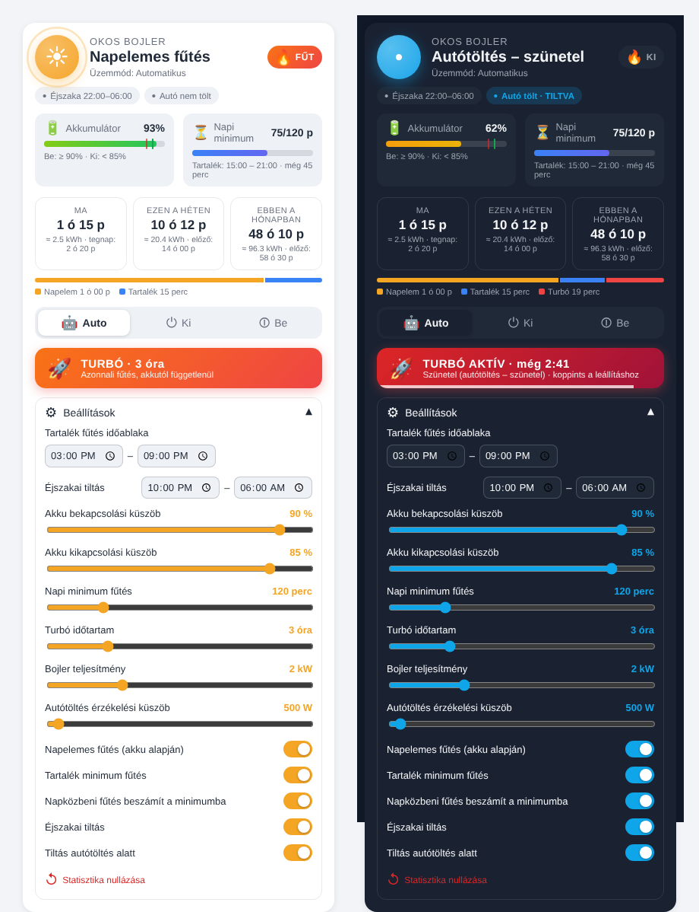

# 🔥 Okos Bojler – napelemes bojlervezérlés Home Assistanthez

Egyszerű (termosztátos, villanyos) bojler vezérlése **egyetlen kapcsolóval** a napelemes rendszer akkumulátorának töltöttsége alapján – tartalék minimum fűtéssel, turbó gombbal, napi/heti/havi fűtési statisztikával és saját Lovelace kártyával.



## Működés

| Prioritás | Mód | Mikor fűt? |
|---|---|---|
| 1 | **Mindig ki** üzemmód | soha |
| 2 | **Mindig be** üzemmód | folyamatosan (kézi felülbírálás, a tiltások erre nem vonatkoznak) |
| 3 | **Autótöltés tiltás** | amíg az autó tölt, **semmi nem fűt** (turbó sem, az csak szünetel) |
| 4 | **Éjszakai tiltás** | a beállított időszakban (alapból 22:00–06:00) **semmi nem fűt** |
| 5 | **Turbó** | a gomb megnyomásától a beállított ideig (alapból 3 óra), akkutól függetlenül |
| 6 | **Napelemes fűtés** | ha az akku ≥ *bekapcsolási küszöb* (90%); addig fűt, amíg az akku a *kikapcsolási küszöb* (85%) alá nem esik (hiszterézis, hogy ne kapcsolgasson) |
| 7 | **Tartalék minimum fűtés** | a beállított időablakban (alapból 15:00–21:00) bekapcsol, ha aznap még nem volt meg a *napi minimum* fűtési idő (alapból 120 perc), és addig fűt, amíg el nem éri |

Ha a „Napközbeni fűtés beszámítása” kapcsoló be van kapcsolva, a napelemes fűtés ideje is beleszámít a napi minimumba (pl. ha délelőtt már fűtött 2 órát, délután nem kapcsol be). Kikapcsolva csak a nem napelemes fűtés számít.

### Autótöltés érzékelése
Beállításkor (vagy utólag az integráció *Beállítások* gombjával) megadható egy opcionális entitás:
- **kapcsoló / bináris szenzor / input_boolean**: `on` = tölt,
- **teljesítmény szenzor** (W vagy kW): tölt, ha a teljesítmény a *küszöb* (alapból 500 W) felett van,
- **szöveges állapot szenzor**: `charging` / `töltés` / `töltődik` = tölt.

A fűtési időt a **kapcsoló tényleges állapota** alapján méri, és a beállított teljesítménnyel becsült energiát (kWh) is mutat.

## Telepítés (HACS)

1. HACS → jobb felső menü → **Egyéni tárolók** → add hozzá a repó címét, kategória: **Integráció**.
2. Telepítsd az **Okos Bojler** integrációt, majd indítsd újra a Home Assistantot.
3. Beállítások → Eszközök és szolgáltatások → **Integráció hozzáadása** → *Okos Bojler*.
4. Válaszd ki a bojler kapcsolót (switch / input_boolean / light) és az akkumulátor töltöttség szenzort (%).

Kézi telepítés: másold a `custom_components/okos_bojler` mappát a HA `config/custom_components/` mappájába.

## Lovelace kártya

A kártya **automatikusan betöltődik**, nem kell erőforrást felvenni. (Telepítés után egy böngésző frissítés kellhet.)

```yaml
type: custom:okos-bojler-card
entity: sensor.okos_bojler_allapot
# title: Fürdőszobai bojler   # opcionális
# show_settings: false        # beállítás panel elrejtése
```

A kártyán: állapot animált jelzéssel, akku sáv a küszöbökkel, napi minimum haladás, mai/heti/havi fűtési idő (+ becsült kWh és előző időszak), mai bontás forrás szerint, üzemmód választó, **TURBÓ gomb** visszaszámlálóval és lenyitható beállítás panel.

## Entitások (alapnév: „Okos Bojler”)

| Entitás | Leírás |
|---|---|
| `sensor.okos_bojler_allapot` | aktuális állapot + minden adat attribútumként |
| `sensor.okos_bojler_futes_ma` / `_futes_het` / `_futes_honap` / `_futes_osszes` | fűtési idő percben (attribútum: óra, becsült kWh, előző időszak) |
| `sensor.okos_bojler_turbo_hatra` | turbóból hátralévő perc |
| `sensor.okos_bojler_minimum_hatra` | napi minimumból hátralévő perc |
| `select.okos_bojler_uzemmod` | Automatikus / Mindig ki / Mindig be |
| `number.okos_bojler_bekapcsolasi_kuszob` | akku % – napelemes fűtés indul (alap 90) |
| `number.okos_bojler_kikapcsolasi_kuszob` | akku % – napelemes fűtés leáll (alap 85) |
| `number.okos_bojler_napi_minimum` | napi minimum fűtés percben (alap 120) |
| `number.okos_bojler_turbo_idotartam` | turbó hossza órában (alap 3) |
| `number.okos_bojler_teljesitmeny` | bojler teljesítmény kW (energia becsléshez) |
| `time.okos_bojler_tartalek_kezdete` / `_tartalek_vege` | tartalék fűtés időablaka (alap 15:00–21:00) |
| `switch.okos_bojler_napelemes_futes` | napelemes fűtés be/ki |
| `switch.okos_bojler_tartalek_futes` | tartalék minimum fűtés be/ki |
| `switch.okos_bojler_napi_beszamitas` | napközbeni fűtés beszámít-e a minimumba |
| `switch.okos_bojler_ejszakai_tiltas` | éjszakai tiltás be/ki |
| `time.okos_bojler_ejszaka_kezdete` / `_ejszaka_vege` | éjszakai tiltás időszaka (alap 22:00–06:00) |
| `switch.okos_bojler_autotoltes_tiltas` | tiltás autótöltés alatt be/ki |
| `number.okos_bojler_autotoltes_kuszob` | W – ennyi felett számít töltésnek |
| `button.okos_bojler_turbo_inditas` / `_turbo_leallitas` | turbó indítás / leállítás |
| `button.okos_bojler_statisztika_nullazas` | statisztika nullázása |

Minden beállítás és a statisztika újraindítás után megmarad. A forrás entitások utólag az integráció **Beállítások** gombjával módosíthatók.

## Megjegyzések

- Ha a tartalék fűtés ablaka belelóg az éjszakai tiltásba, a tiltás erősebb – állítsd úgy az időket, hogy a minimum beférjen (pl. tartalék 15:00–21:00, éjszaka 22:00–06:00).
- Ha 1.0-ról frissítesz és autótöltőt akarsz megadni: integráció → *Beállítások*.
- A heti statisztika hétfőn, a havi a hónap első napján nullázódik; az előző időszak értéke attribútumként megmarad.
- A heti/havi szenzorok `total_increasing` típusúak, így a HA hosszú távú statisztikájában és az Energia/History grafikonokon is használhatók.
- A bojler saját termosztátja továbbra is működik: ha a víz felmelegedett, a bojler magától nem fűt, de a kapcsoló bekapcsolt állapotban marad – a mért idő ezért a *bekapcsolt* időt jelenti. Ha pontos fűtési időt szeretnél, használj fogyasztásmérős konnektort.
- A HACS feltöltés előtt a `manifest.json`-ben cseréld ki a `FELHASZNALONEV` részt a saját GitHub neveddel.
